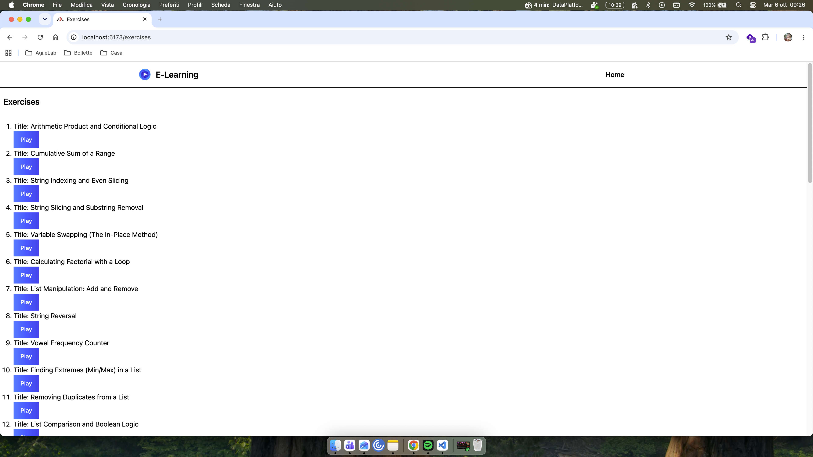
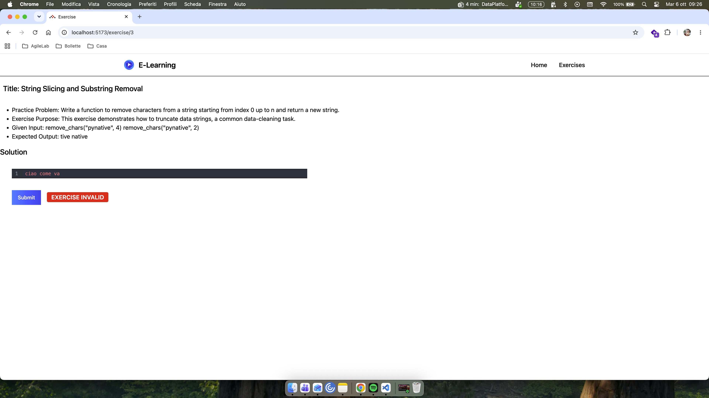
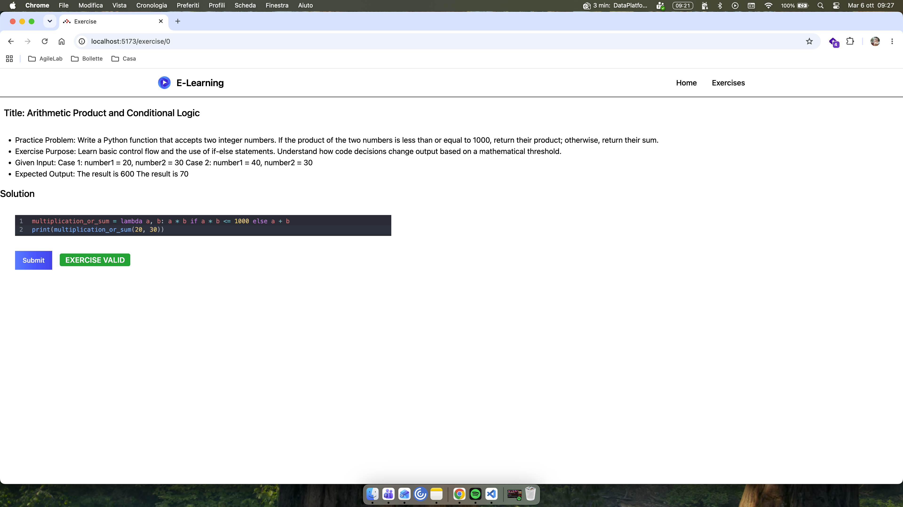

# Python Code Validator with LLM

## Get Started 


```bash
python -m venv venv
make install
make sample_syntax_exercises
make sample_correctness_validator

```

### BIFI syntax fine-tuning (LoRA)

The optional training pipeline fine-tunes a causal code model with LoRA to classify
Python fragments as `VALID` or `INVALID`. It reads the BIFI minimal archive after
extraction; good and bad examples are loaded from `orig_good_code` and
`orig_bad_code`, respectively. JSON records use their `code_string` field. The
dataset is split into a seeded, stratified train/test split (10% test by default).

```bash
make download_datasets
make install
make train_bifi_syntax DATA_DIR=data/bifi/data
make predict_bifi_syntax ADAPTER=models/bifi-syntax/adapter CODE='def f(:'
```

The default base model is `Qwen/Qwen2.5-Coder-1.5B-Instruct`; override it with
`MODEL=...` on the Python command, for example:

```bash
python -m src.training.bifi_syntax train --data data/bifi --model Qwen/Qwen2.5-Coder-3B-Instruct
python -m src.training.bifi_syntax predict --adapter models/bifi-syntax/adapter --code $'def f():\n    return 1'
```

The saved adapter is a Transformers/PEFT artifact, not a GGUF model: existing
Ollama/llama.cpp services cannot load it directly. Training defaults are
conservative and can be tuned with
`--epochs`, `--batch-size`, `--max-length`, and other CLI options.


### Scripts 


- `make sample_syntax_exercises`: Run several exercises of syntax validation , just a language compiler simulation.
- `make sample_correctness_validator`: Run several exercises to evalute the correctness of python challenges.
- `make sample_syntax_validator`: Validate the syntax of a little batch of python code.
- `make sample_correctness_exercises`: Run one exercise to evalute the correctness of python challenges.
- `make sample_complexity_exercises`: Run a batch of snippets to evaluate the time complexity (Big-O) classification against the expected one.

### Metrics

Every experiment prints the same classification report, built by `src/metrics/classification.py`:
accuracy, per class precision/recall/F1 with support, plus macro and weighted (by support) averages.
Averages are computed only over the classes present in the ground truth; answers the model did not
express in the expected format are collected in the `UNPARSED` pseudo class, so they always count as
errors and never inflate the precision of a real class.

# Run the Interactive Validator

```bash
make run_backend
```

Open a new bash window

```bash
make run_frontend
```


You'll find a list of courses and exercises that you can interactively validate using a practical Python IDE.

Samples :





